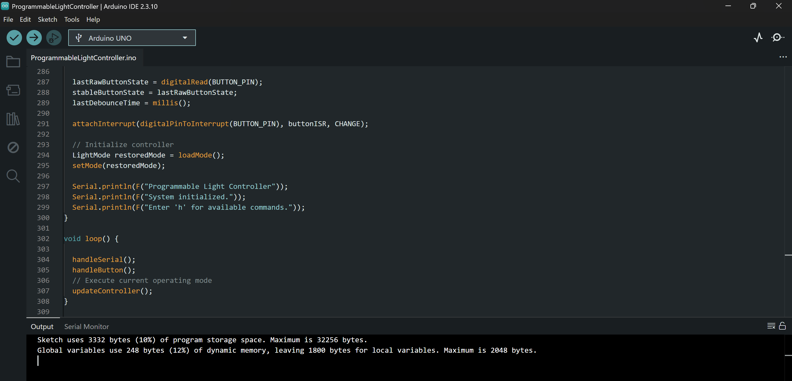
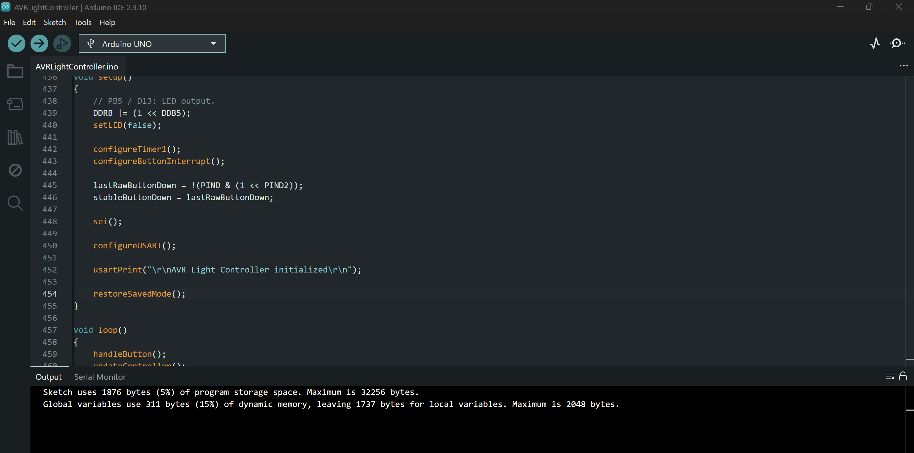
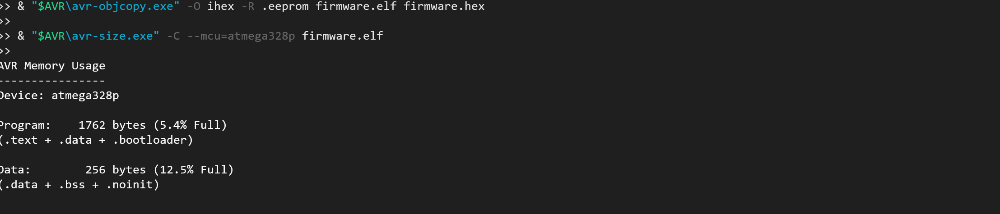

# Firmware Memory Footprint Comparison

This document compares the compiled program-memory (flash) and statically allocated SRAM footprints of three implementations of the same programmable light controller on an **Arduino Uno R3 (ATmega328P, 16 MHz)**.

The implementations share the same intended behavior: OFF, ON, BLINK (500 ms toggle), and TIMED (10 s) modes; pushbutton mode cycling with debounce and long-press reset; 9600-baud serial commands; and EEPROM mode persistence.

## Implementations

| Implementation | Build and software architecture |
|---|---|
| [Arduino Framework](arduino-framework/README.md) | Arduino IDE 2.3.10, Arduino GPIO/timing/serial/EEPROM APIs |
| [AVR Register-Level](avr-register-level/README.md) | Arduino IDE 2.3.10, direct peripheral registers in an `.ino` sketch, retaining Arduino startup infrastructure |
| [Standalone AVR-GCC](avr-standalone/README.md) | Direct AVR-G++ build, standalone `main()`, no Arduino core; optimized with `-Os` |

## Measured results

| Implementation | Flash (bytes) | Flash (% of 32,256 B application space) | Static SRAM (bytes) | SRAM (% of 2,048 B) |
|---|---:|---:|---:|---:|
| Arduino Framework | 3,332 | 10.3% | **248** | 12.1% |
| AVR Register-Level | 1,876 | 5.8% | 311 | 15.2% |
| Standalone AVR-GCC | **1,762** | **5.5%** | 256 | 12.5% |

**Measurement sources:** Arduino IDE 2.3.10 Verify output for the first two implementations; `avr-size -C --mcu=atmega328p firmware.elf` for the standalone version. Flash percentages here use the Uno's **32,256-byte application limit** (excluding its bootloader area); SRAM percentages use its 2,048-byte capacity. The standalone size report may display a different flash percentage if it uses the full 32 KiB physical flash capacity as its denominator.

### Flash and SRAM differences

Changes are relative to the first implementation named in each row. A positive SRAM change indicates **more** SRAM used.

| Comparison | Flash difference | Flash change | Static SRAM difference | SRAM change |
|---|---:|---:|---:|---:|
| Framework → Register-Level | −1,456 B | **−43.7%** | +63 B | +25.4% |
| Register-Level → Standalone | −114 B | **−6.1%** | −55 B | −17.7% |
| Framework → Standalone | −1,570 B | **−47.1%** | +8 B | +3.2% |

## Compilation evidence

Add the original screenshots to `comparison-evidence/` and replace the placeholders below with actual image links. Keep the screenshots unedited where possible so the compiler output and selected target board remain visible.

### Arduino Framework — Arduino IDE compilation output

> **Screenshot pending:** `comparison-evidence/arduino-framework-memory.png`

<!-- After uploading, replace the placeholder above with:

-->

Observed output: **3,332 bytes flash; 248 bytes global/static SRAM**.

### AVR Register-Level — Arduino IDE compilation output

> **Screenshot pending:** `comparison-evidence/avr-register-level-memory.png`

<!-- After uploading, replace the placeholder above with:

-->

Observed output: **1,876 bytes flash; 311 bytes global/static SRAM**.

### Standalone AVR-GCC — avr-size output

> **Screenshot pending:** `comparison-evidence/avr-standalone-memory.png`

<!-- After uploading, replace the placeholder above with:

-->

Observed output: **1,762 bytes flash; 256 bytes static SRAM**.

## Engineering interpretation

**Direct register-level firmware reduced flash use substantially.** Compared with the Arduino Framework implementation, the register-level sketch uses 1,456 fewer bytes of flash (43.7% less). It bypasses Arduino GPIO, timing, serial, and EEPROM APIs for the controller logic, although it is still compiled as an Arduino sketch.

**Removing Arduino startup/build dependencies saved additional flash.** The standalone firmware is 114 bytes smaller (6.1%) than the register-level sketch. Most of the observed flash reduction occurred before the application became fully standalone.

**SRAM use is not monotonically lower with lower-level programming.** The register-level implementation uses 311 bytes of static SRAM, compared with 248 bytes for the framework implementation and 256 bytes for the standalone version. The standalone version has the smallest flash footprint, while the framework version has the smallest static SRAM footprint.

**These are application-level measurements, not isolated API benchmarks.** The programs are functionally comparable but not instruction-for-instruction identical. Differences in source structure, libraries, startup code, toolchain versions, and compiler/linker options can affect size. The figures describe the specific compiled builds shown here; they do not prove that register access always saves a fixed percentage of memory.

**Static SRAM is not peak runtime SRAM.** The reported values include statically allocated data but do not measure stack high-water mark, available stack headroom, or worst-case interrupt nesting.

## Separate performance investigations

CPU execution time and interrupt latency will be measured and documented **independently**, rather than inferred from firmware size:

- **[CPU Execution Time Comparison](CPU-EXECUTION-TIME.md)** — separate study, not yet measured/documented
- **[Interrupt Latency Comparison](INTERRUPT-LATENCY.md)** — separate study, not yet measured/documented

These links are planned document names; the files will be created when each investigation begins. No CPU-speed or interrupt-latency conclusions are claimed in this memory-footprint study.
